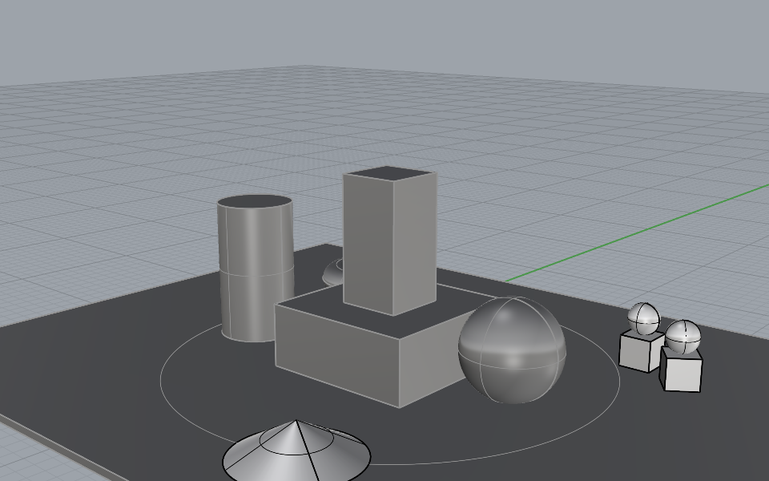
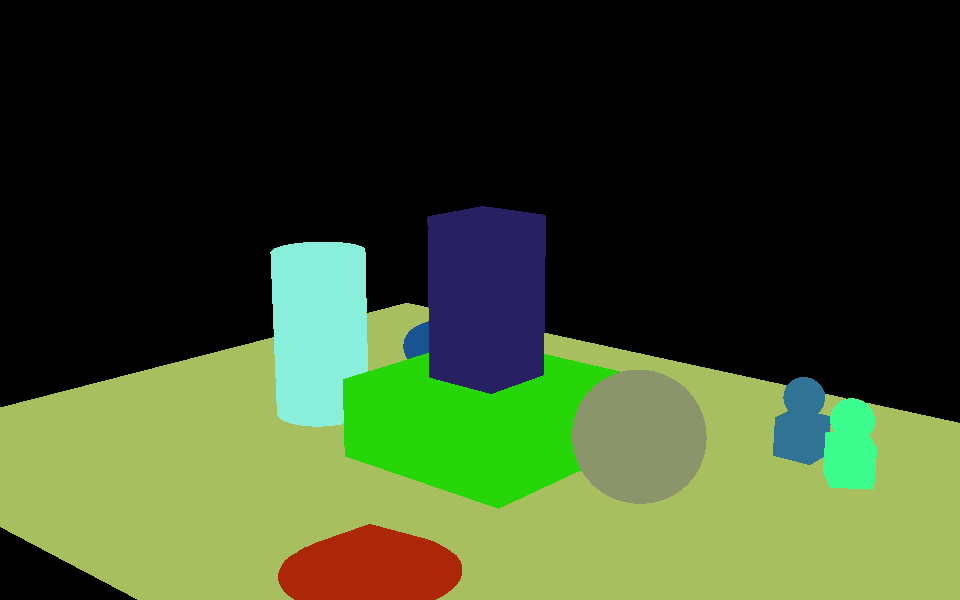

# Clown ID — an object-ID pass for Rhino 8

A Rhino 8 plug-in that shows the **clown pass** (object-ID mask) live in the viewport and
exports it as a clean mask for compositing. Every object is drawn in one flat, unlit colour
derived from its id. Pick an object's colour in Photoshop or Affinity, and you have a
perfect selection that lines up with your render.

| Shaded | Clown ID |
|---|---|
|  |  |

## Use

1. **`ClownId`**: switches the active viewport to the *Clown ID* display mode; run it again
   to switch back to the mode it had before. You can also pick *Clown ID* from any
   viewport's display mode menu, e.g. one viewport rendered, one in Clown ID.
2. **`ClownIdCapture`**: saves the active view as a PNG plus a JSON file next to it.
   *Width* and *Height* default to the viewport size. Set them to your render size so the
   pass lines up with the render pixel for pixel.

What you get:

- **One colour per object, stable.** The colour is a hash of the object's id, so the same
  object has the same colour in every session, every capture, every saved file. Block
  instances get one colour per instance.
- **Exact colours.** The colour goes straight to the frame buffer: no lighting, shading,
  gamma or tone mapping. Anti-aliased edge pixels in the capture are snapped to the colour
  of a neighbouring object, so every pixel of the PNG is exactly one object or the black
  background.
- **Only surfaces.** Black background; no grid, axes, curves, edges, points, annotations
  or lights.
- **A colour key.** The JSON lists every visible object with its colour, id, name, layer,
  type and pixel count. See [docs/clown-id-pass.json](docs/clown-id-pass.json).

Scripted form, e.g. for macros:

```
-ClownIdCapture Width=1920 Height=1200 Enter /path/to/pass.png Enter
```

## Install

Build it (below), then drag `bin/Release/net7.0/ClownId.rhp` into a Rhino 8 window.
On Windows you can also use the `net48` build. The plug-in loads with Rhino from then on.

## Build

Requires the [.NET SDK](https://dotnet.microsoft.com/download) 7 or later.

```sh
dotnet build -c Release
```

Rhino can't unload a plug-in: restart Rhino after rebuilding to pick up changes.
`Properties/launchSettings.json` has profiles to start Rhino 8 (Mac and Windows) with the
build output loaded.

## How it works

| File | Role |
|---|---|
| `ClownDisplayMode.cs` | Creates the *Clown ID* display mode (a copy of Shaded, so Rhino keeps building render meshes) and switches everything but surfaces off. |
| `ClownIdConduit.cs` | In Clown ID viewports: paints the background black, stops Rhino drawing each object, and redraws its render meshes with an emission-only material in the object's colour. |
| `ClownColors.cs` | Object id → colour (FNV-1a hash, kept clear of black). |
| `ClownIdCommand.cs` | `ClownId`, the viewport toggle. |
| `ClownIdCaptureCommand.cs` | `ClownIdCapture`: captures the view, snaps edges, writes PNG and JSON. |
| `ClownMask.cs` | Snaps off-palette edge pixels to the closest exact neighbour colour. |

Quirks of the Rhino 8 display pipeline this works around:

- Meshes drawn in `PreDrawObject` all receive the first material of the frame. Objects
  are collected there and drawn in `PostDrawObjects` instead.
- A display mode's solid background and grid switches are not honoured in every view, so
  the conduit paints the background itself, and captures go through `ViewCapture` with
  grid and axes off.
- On the Mac, `System.Drawing.Bitmap.LockBits` is not supported inside Rhino; pixel
  access goes through `Eto.Drawing.Bitmap`.

## Notes

- Colours come from a hash, so two objects can, rarely, share one. `ClownIdCapture`
  reports it and lists them under `collisions` in the JSON.
- Grasshopper previews are not document objects and draw normally. Bake them first.
- Tested on Rhino 8.35 for Mac.
